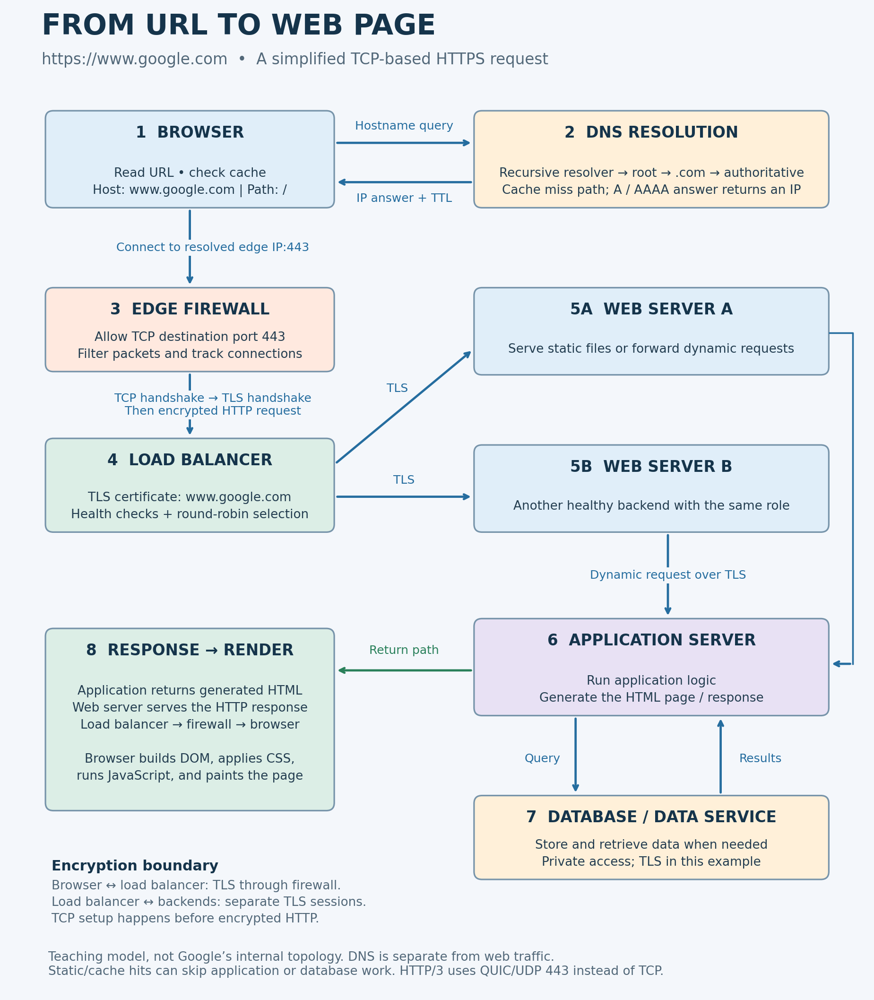

# What Happens When You Type https://www.google.com and Press Enter?

By Abeer Al-Saiari

Opening a website feels like one action, but several systems work together before the page appears. In an interview, I would first ask whether to focus on networking, backend infrastructure, or browser rendering. Here, I will follow the request from the browser to the server and back.

This is a simplified web architecture for learning. It is not a diagram of Google's private infrastructure. I will describe a fresh HTTPS connection using TCP; HTTP/3 is an important alternative discussed below.

## 1. The browser reads the URL

The browser separates the address into the scheme, `https`, and the hostname, `www.google.com`. With no explicit path, the initial request is for `/`. HTTPS normally uses port **443**.

The browser may reuse cached content or an existing connection. To explain the whole journey, assume it needs to contact the website and does not already have a usable connection.

## 2. DNS finds an IP address

A hostname is easy to remember, but network packets need an IP destination. The Domain Name System, or DNS, connects these two forms of addressing.

The browser and operating system can use cached DNS answers. If no usable answer is available, the client asks its configured recursive DNS resolver. The resolver checks its own cache. On a cache miss, it follows the DNS hierarchy: a root nameserver refers it to the `.com` nameservers, and a `.com` nameserver refers it to the authoritative nameservers for `google.com`. The resolver asks the appropriate authoritative server about `www.google.com`.

An **A record** supplies an IPv4 address; an **AAAA record** supplies an IPv6 address. An alias may require further lookups. The resolver returns the result, which can be cached according to its time to live (TTL).

Google can have multiple addresses, so there is no single permanent IP to memorize. DNS resolves a hostname, not the full URL or its path. Ordinary DNS commonly uses UDP or TCP port 53; encrypted DNS can use HTTPS or TLS. The website's HTTPS connection does not automatically encrypt a separate DNS lookup.

## 3. TCP/IP moves the data

The browser connects to the resolved server or edge IP on port 443, using an available temporary source port on the client. Routers forward IP packets across networks toward that destination. The public IP may belong to the site's load-balancing edge rather than its application server.

For a new TCP connection, the client sends **SYN**, the server replies **SYN-ACK**, and the client sends **ACK**. This three-way handshake establishes the connection. TCP provides an ordered byte stream, acknowledgments, retransmission of lost data, and flow and congestion control. IP handles addressing and packet routing; IP alone does not guarantee delivery.

## 4. A firewall checks the connection

Firewalls can enforce rules on the client, at the network edge, and between backend services. In the diagram, an edge firewall permits the public HTTPS connection to port 443 and rejects traffic that does not match its rules. A stateful firewall can track the connection and permit its response traffic.

The firewall applies during connection establishment, not only after the HTTP request exists. Private application and database ports should not be open to arbitrary internet clients. A network firewall does not automatically decrypt HTTPS; application-level inspection requires access to decrypted traffic, for example through a web application firewall at the TLS termination point.

## 5. HTTPS protects the request with TLS

HTTPS is HTTP protected by **TLS**. People still say “SSL certificate,” but SSL is the older predecessor of TLS.

After establishing TCP in this example, the browser and the TLS endpoint negotiate security parameters. The endpoint presents a certificate, and the browser checks its trust chain, validity period, and whether it covers `www.google.com`. The handshake authenticates the server and establishes shared session keys.

Once the handshake succeeds, HTTP requests and responses are encrypted and integrity-protected. Someone observing the network cannot simply read the page content or change it undetected, although metadata such as destination IPs remains visible.

In this design, the load balancer terminates the browser's TLS connection. It uses a separate TLS connection to the selected web server. That second connection matters: terminating TLS at the edge does not by itself encrypt backend traffic.

## 6. The load balancer chooses a healthy server

The browser now sends an HTTP request for `/`, identifying `www.google.com` as the host. For illustration, its HTTP/1.1 form starts with `GET / HTTP/1.1` and includes `Host: www.google.com`.

A load balancer spreads requests across multiple web servers. Our example uses round robin: successive requests are assigned to eligible servers in turn. Health checks remove failing servers from the available pool. This helps distribute work and keeps one unhealthy backend from receiving new requests.

Other algorithms can consider active connections or server weights. Round robin here is a teaching choice, not a claim about Google's actual algorithm.

## 7. The web server handles HTTP

A web server accepts the forwarded request and sends an HTTP response. It can serve static files such as images, CSS, or JavaScript directly. When the request needs application logic, it forwards the work to an application server.

These are different responsibilities: the web server handles HTTP delivery and static content, while the application server runs the code that decides what the response should contain. They can be separate processes or services.

## 8. The application server uses data to build a response

The application server may evaluate a session, choose a language, or generate HTML. If it needs stored data, it queries a database or another data service over the private network. The database stores and retrieves persistent information; it sends results back to the application server, not directly to the browser.

For example, a generic application could read a saved preference and use it to build a personalized page. The diagram shows that optional database-backed path. Cached or static responses may skip it entirely.

Opening Google's homepage is also different from submitting a search. Google explains that search results come from its index, built through crawling and indexing. It does not scan the entire live web for every search. The database box represents a data layer generally, not a claim that Google uses one MySQL database or queries it for every homepage visit.

## 9. The response returns and the browser renders it

The application returns generated content to the web server. The web server sends the HTTP response through the load balancer and firewall to the browser. A successful response can contain a `200` status, headers describing the content, and an HTML body. Errors and redirects can produce other status codes.

The browser parses HTML into the DOM, processes CSS, and runs JavaScript. It calculates layout and paints the page. Images, fonts, scripts, and stylesheets can trigger additional requests; cached resources and existing connections can reduce the work.

## A note about HTTP/3

Not every HTTPS visit uses TCP. HTTP/3 uses QUIC over UDP, normally on port 443, with TLS 1.3 integrated into QUIC. The TCP handshake described above applies to the TCP-based path, such as HTTPS using HTTP/1.1 or HTTP/2. Firewall rules must allow UDP 443 when supporting HTTP/3.

## Request flow diagram

The two web servers are alternatives selected by the load balancer. DNS is a separate lookup, not a proxy carrying the web request. The diagram's private connections use TLS as a design choice. A dynamically generated page returns through the same service chain; a static or cached response can stop earlier.

## What I learned

One page load brings together naming, routing, reliable transport, encryption, traffic filtering, request distribution, application logic, storage, and rendering. Understanding the role of each part makes it easier to explain a slow page or identify where a failed request might be getting stuck.

## References

- [Cloudflare: Recursive DNS](https://www.cloudflare.com/learning/dns/what-is-recursive-dns/)
- [Cloudflare: DNS servers](https://www.cloudflare.com/learning/dns/what-is-a-dns-server/)
- [MDN: How the web works](https://developer.mozilla.org/en-US/docs/Learn_web_development/Getting_started/Web_standards/How_the_web_works)
- [Cloudflare: Firewalls](https://www.cloudflare.com/learning/security/what-is-a-firewall/)
- [Cloudflare: TLS handshakes](https://www.cloudflare.com/en-ca/learning/ssl/what-happens-in-a-tls-handshake/)
- [HAProxy: Backends and balancing](https://www.haproxy.com/documentation/haproxy-configuration-tutorials/proxying-essentials/configuration-basics/backends/)
- [Google: How Search works](https://developers.google.com/search/docs/fundamentals/how-search-works)
- [MDN: How browsers load websites](https://developer.mozilla.org/en-US/docs/Learn_web_development/Getting_started/Web_standards/How_browsers_load_websites)
- [MDN: QUIC](https://developer.mozilla.org/en-US/docs/Glossary/QUIC)
